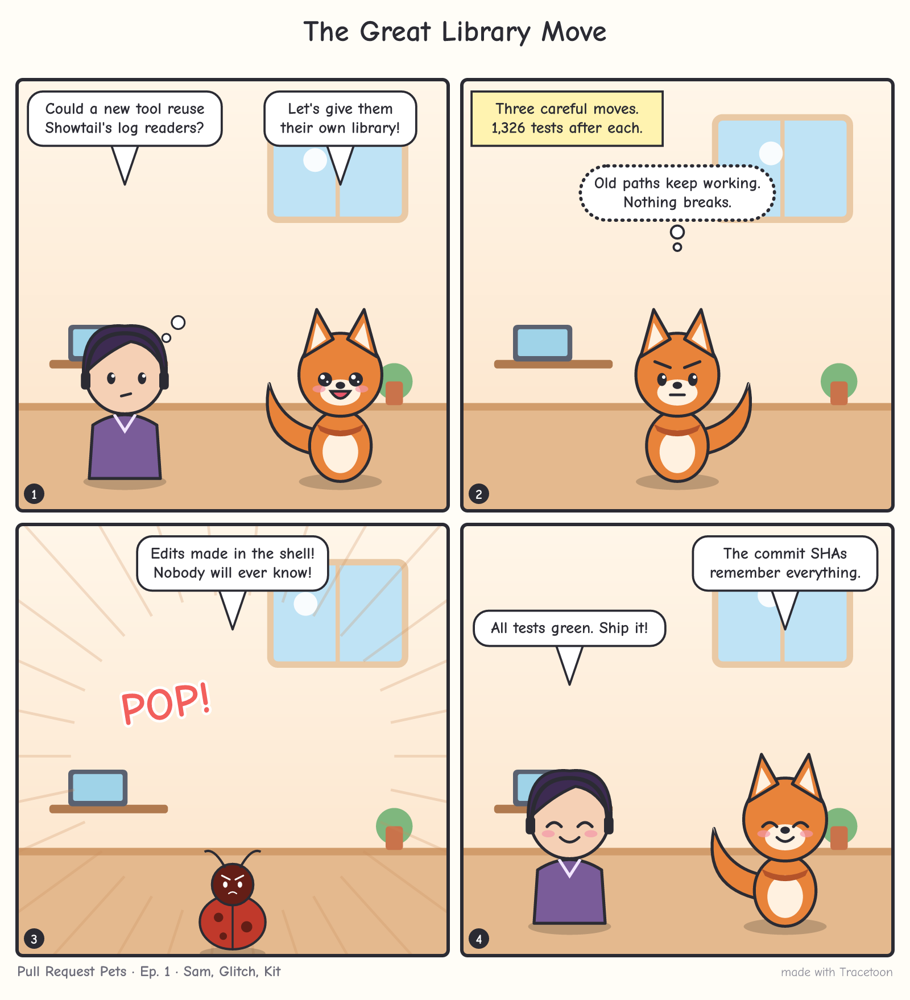

# Tracetoon

**Pull requests that show how the change was made, with a comic.** Tracetoon
reads the session logs your AI coding agents already keep on your machine, finds
the sessions that produced your branch, and helps your agent write a PR
description covering the plan, the decisions, what was tested, and how much was
AI-assisted. It adds a four-panel comic of the story, starring a recurring cast.
You see the exact text and comic and approve them before anything is posted.

<p align="center"></p>

- **Install after the fact.** Write your code first with any supported agent,
  then add Tracetoon. It reads logs that already exist: no hooks, no background
  capture, no history database.
- **Preview first.** Posting requires an approval code tied to the exact text
  and image you previewed. An optional yolo mode skips the preview only when
  every safety check passes.
- **Private by default.** Only records from this repository are used. Secrets,
  personal data, your home path and username are redacted, and a second scanner
  checks the final text before it can be posted. Image services only ever see
  the comic's scenes, and only after you agree.
- **A story that continues.** Each repo gets a series: the same characters
  return, episodes are numbered, and related PRs (stacked branches, shared
  sessions) are linked as a saga with a "previously on" recap.

| Agent | Status |
|---|---|
| Claude Code | supported |
| Codex (CLI and app) | supported |
| Antigravity (CLI and IDE) | supported |
| Copilot CLI | planned |

## Use it

### Claude Code

```text
/plugin marketplace add Tingsters/tracetoon
/plugin install tracetoon@tracetoon
```

Then ask: *"Open a PR for this branch with Tracetoon."*

### Codex, Antigravity, Gemini CLI and other Agent Skills hosts

Copy `plugin/skills/tracetoon/` (or unzip `tracetoon-skill.zip` from a
[release](https://github.com/Tingsters/tracetoon/releases)) into your agent's
skills folder:

| Agent | Folder |
|---|---|
| Codex | `~/.agents/skills/tracetoon` (or `.agents/skills/` in a repo) |
| Antigravity | `~/.gemini/antigravity/skills/tracetoon` |
| Gemini CLI | `~/.gemini/skills/tracetoon` |

## How it works

1. **`tracetoon digest`** reads the branch from git (base, commits, the exact
   lines added), finds agent sessions that touched this repository, and scores
   them. The evidence: edits whose lines are still in the diff, commits made
   during the session (this also finds work done in worktrees since deleted), a
   PR link, the branch, timing and working folder. Subagents fold into their
   parent session. The result is a redacted digest sized for an LLM.
2. **`tracetoon context`** reads the PR template, any AI-contribution policy, the
   existing PR, your settings, and the comic series (cast, episode number,
   saga).
3. **Your agent writes** `body.md` and a four-panel `comic.json` from the digest.
4. **`tracetoon comic art` / `comic render`** draw the panels and add speech
   bubbles. Art comes from your agent's own image tool (Codex, Antigravity),
   Gemini or OpenAI if you have a key and agree, or the built-in artist (no key
   needed; that's what drew the comic above).
5. **`tracetoon render`** builds the final body (Tracetoon only owns a marked
   region, so your own text in an existing PR is kept), scans it for leaks and
   prints an approval code.
6. **`tracetoon publish --code <code>`** uploads the comic to the repo's
   `tracetoon-assets` branch (or as a GitHub attachment for private repos) and
   creates or updates the PR with `gh`.

Other commands: `scan`, `expand`, `preview`, `series`,
`export --agent-trace` ([Agent Trace](https://agent-trace.dev) line attribution),
`doctor --probe`, `config`. Every command takes `--json`.

If the repo already records provenance with [Entire](https://entire.io)
checkpoints or git-ai notes, the digest says so. Run files live in
`.git/tracetoon/runs/`, which git never tracks.

## Running it

The skill ships a small launcher (`bin/tracetoon`, `bin/tracetoon.cmd`). It uses,
in order: a prebuilt binary next to it or cached, Bun, or Node 22+ with the
bundled `dist/tracetoon.mjs`. With your permission it can instead download the
release binary with `gh` and verify its checksum. Per-platform skill zips with
the binary included are attached to each release.

## Settings

`tracetoon config set <key> <value>`, or per repo in `.github/tracetoon.json`:

| Key | Default | Meaning |
|---|---|---|
| `theme` | `pets` | Comic theme for a new series: `pets`, `mecha` or `scifi` |
| `comic` | `true` | Make a comic at all |
| `yolo` | `false` | Allow `publish --yolo` to skip the preview when all checks pass |
| `promptQuoting` | `paraphrase` | `verbatim` quotes your prompts in the PR |
| `disclosure` | `assisted-by` | Trailer style to suggest |
| `hosting` | `auto` | Where the comic goes: `branch`, `attach`, or `auto` |
| `imageConsent` | `[]` | Image services you agreed to (set by `comic art --consent`) |
| `budgetTokens` | `12000` | Digest size |

Image generation uses `GEMINI_API_KEY` (model `gemini-3.1-flash-image`,
override with `TRACETOON_GEMINI_MODEL`) or `OPENAI_API_KEY` (`gpt-image-2`,
override with `TRACETOON_OPENAI_MODEL`).

## Develop

```sh
git clone https://github.com/Tingsters/Showtail ../Showtail   # shared log readers
bun install
bun test
bun run typecheck
bun run bundle      # rebuilds plugin/skills/tracetoon/dist/tracetoon.mjs
```

Tracetoon builds on [`@showtail/agent-traces`](https://github.com/Tingsters/Showtail/tree/main/packages/agent-traces),
the log readers and redaction shared with [Showtail](https://github.com/Tingsters/Showtail).
Until that package is on npm, development expects a Showtail checkout next to
this repo (see `tsconfig.json` paths). See [CONTRIBUTING.md](CONTRIBUTING.md).

Apache-2.0. The bundled Comic Neue font is under the SIL Open Font License
(`plugin/skills/tracetoon/assets/fonts/OFL.txt`).
