<h1 align="center">💥 Tracetoon</h1>

<p align="center"><b>PRs with receipts. And comics.</b></p>

<p align="center">
  <a href="https://tracetoon.com"></a>
  <a href="https://github.com/Tracetoon/tracetoon/releases"></a>
  <a href="https://github.com/Tracetoon/tracetoon/actions/workflows/ci.yml"></a>
  <a href="LICENSE"></a>
  <a href="#-contributing-ai-welcome-comics-wanted"></a>
</p>

<p align="center"><a href="https://tracetoon.com">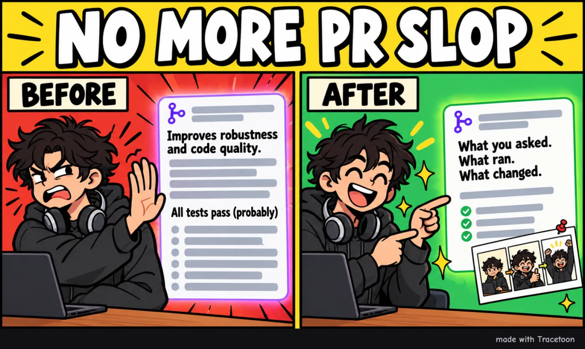</a></p>

Your coding agent already kept the receipts: what you asked for, what it
changed, what actually ran. **Tracetoon turns them into a pull request reviewers
can trust.** Every claim is checked against the evidence, it costs less to
write, and there's a comic on top.

<div align="center">

|                       **18–1**                        |                 **0**                  |          **−41%**           |
| :---------------------------------------------------: | :------------------------------------: | :-------------------------: |
| head-to-head wins over the no-graph workflow (Claude) | factual errors in 25 Codex-written PRs | cost per PR: $0.41 vs $0.69 |

<sub>From prbench: 5 real PRs from Tracetoon's own development, 5 drafts per PR
per setup, scored by AI judges. The sample is small and scores vary by about ±3
points between runs, so read these as development numbers. See the
<a href="https://tracetoon.com/evidence-graph.html">full results</a>, methods
and caveats.</sub>

</div>

**Contents:** [Quick start](#-quick-start) ·
[Better PRs](#-better-prs-judged-blind-picked-almost-every-time) ·
[Evidence graph](#%EF%B8%8F-evidence-graph-every-sentence-has-a-receipt) ·
[Embedded DB](#-embedded-database-a-graph-database-that-fits-in-your-pocket) ·
[Cost](#-cost-a-sharp-brief-lets-cheap-workers-check-the-work) ·
[Comics](#-comics-a-comic-nobody-asked-for-everyone-reads-it) ·
[Workflow](#-fits-your-workflow-it-knows-the-house-rules) ·
[Under the hood](#-under-the-hood-from-session-logs-to-a-reviewed-pr) ·
[Install & update](#-install-update-uninstall) ·
[Reference](#%EF%B8%8F-reference) ·
[Talk](#-watch-the-talk) ·
[Contributing](#-contributing-ai-welcome-comics-wanted)

---

## ⚡ Quick start

**1. Install it for every agent on your machine.** It's one command, ships a
prebuilt binary, and needs nothing else:

```sh
# macOS, Linux, Git Bash
curl -fsSL https://raw.githubusercontent.com/Tracetoon/tracetoon/main/install.sh | sh
```

```powershell
# Windows PowerShell
irm https://raw.githubusercontent.com/Tracetoon/tracetoon/main/install.ps1 | iex
```

**2. Restart your agent.** Then, on any branch with your work, ask:

> _"Open a PR for this branch with Tracetoon."_

Or just let your agent run `gh pr create` as usual: a hook sends it through
Tracetoon. When the PR is up, you get a short report:

```text
Tracetoon created PR #34: https://github.com/o/r/pull/34
Comic: included.
Left out: 1 session that may not belong to this PR.
Comics: tracetoon config set comic off|allowed|always (now: allowed)
```

| Agent                     | Status                                                                       |
| ------------------------- | ---------------------------------------------------------------------------- |
| Claude Code               | ✅ supported                                                                 |
| Codex (CLI and app)       | ✅ supported                                                                 |
| Antigravity (CLI and IDE) | ✅ supported                                                                 |
| Factory Droid             | ✅ supported                                                                 |
| Copilot (CLI and VS Code) | ✅ supported                                                                 |
| Gemini CLI                | 🟡 legacy: runs the skill (replaced by Antigravity CLI for individual users) |
| Cursor, Windsurf          | 🗓️ planned                                                                   |

> [!TIP]
> Already installed? Ask your agent: _"Update Tracetoon."_ It works for the
> installer, the plugin and a hand-installed skill. See
> [Install, update, uninstall](#-install-update-uninstall) for the details.

---

## 🧾 Better PRs: judged blind, picked almost every time

<p align="center"><a href="https://tracetoon.com/#why">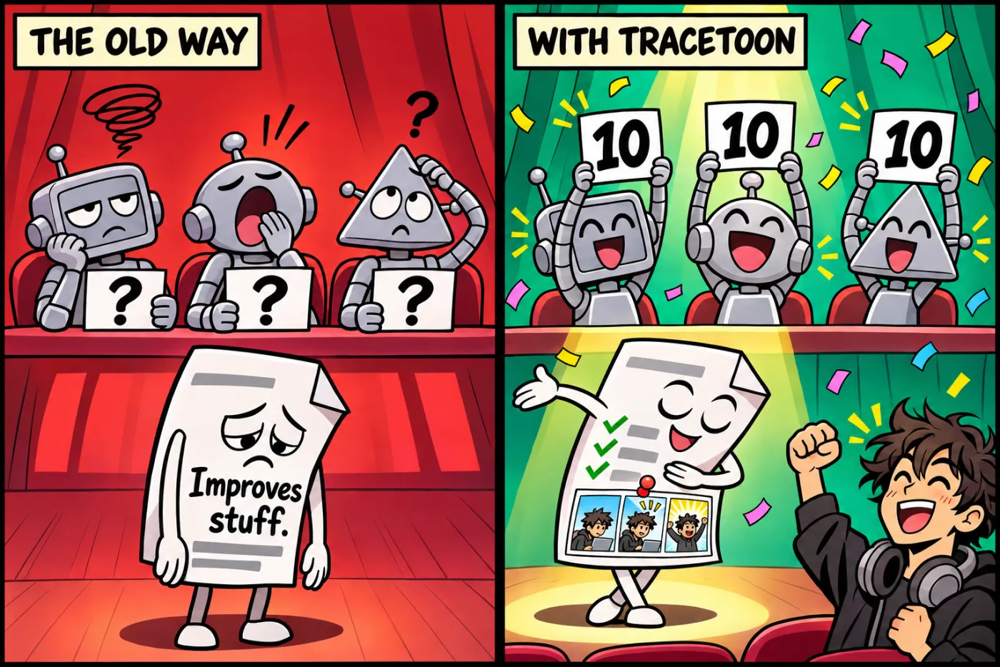</a></p>

AI-written PRs are usually vague and padded, and they sound sure about tests
nobody saw pass. Claude Code, Codex, Antigravity, Factory Droid and Copilot already keep session logs on
your machine. Tracetoon finds the sessions that produced this branch and turns
them into a redacted evidence brief your agent writes from.

- **Written from evidence.** The PR covers what you asked for, the plan you
  approved, the decisions you made, and every test, build and lint run with its
  result. It never invents a motivation, and it never says "all tests pass"
  unless a run showed it.
- **Honest about what's known.** A run that passed _before_ the last edits is
  described that way. Something that wasn't captured is "not captured", not
  "not done".
- **Short and reviewable.** The problem and the result come first, then the
  reason for the approach, what was checked, and where to start reviewing.
  There are no file-by-file lists and no test-count inventories.
- **Checked before it's posted.** Deterministic checks run first: a leak scan,
  freshness, and a claim check that marks sentences the evidence contradicts or
  doesn't establish. Then two cheap independent reviewers check the draft
  against the diff.
- **Optional notes, never a form.** Tracetoon lists what a reviewer may want
  that the logs don't show, such as a manual check or the reason for a choice.
  Add them or skip them.
- **Your words stay yours.** Text you write in the PR, or edit on GitHub later,
  is kept on the next update. Tracetoon only owns a marked region of the body.

Here is one real PR, written three ways and scored 0–100 by the same judges:

| Who wrote it                   | Score  |
| ------------------------------ | :----: |
| The agent alone                |   47   |
| Tracetoon, old workflow        |   65   |
| **Tracetoon + evidence graph** | **80** |

Head to head, Tracetoon with the graph beat its own no-graph workflow
**18–1** on Claude and **12–1** on Codex. A win only counts when two judges each
read both orders and all four readings agree.

---

## 🕵️ Evidence graph: every sentence has a receipt

<p align="center"><a href="https://tracetoon.com/#graph">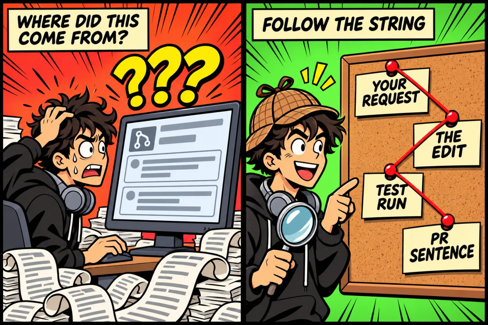</a></p>

Before any model writes a word, Tracetoon builds a small graph of your branch
(`evidence-graph.json` in the run folder). It links every change in the diff
back to the conversation that produced it:

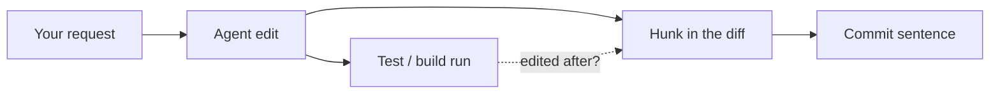

- **Credit goes to the right code.** The brief names the function that owns
  each behavior and marks what's new and what only changed. It also flags code
  where a word like "always" would be wrong.
- **Validation comes from receipts.** Tracetoon writes the Validation section
  from the test and build runs on the final code. The model never gets to type
  "all tests pass".
- **The why, not just the what.** Plans, decisions and the original request
  come along with the code. In the evaluation, context coverage rose 5–7 points.
- **Relevance, not recency.** The graph decides what the digest keeps when it
  has to trim, and names the files a cited test run didn't see.

Your agent asks the graph questions instead of rereading every fact and the
whole patch:

```sh
tracetoon query brief            # the compact evidence brief the drafter writes from
tracetoon query outline          # changed units, their requests and checks
tracetoon query why src/foo.ts   # which request and which runs are behind this file (or a hunk: H3)
tracetoon query unverified       # changes no run saw after their last edit
tracetoon query stale R2         # what changed after run R2
tracetoon query --cypher 'MATCH (h:Hunk) RETURN h.path LIMIT 5'   # read-only Cypher
```

Named queries also include `verified`, `unexplained`, `turn <S#>`, `dead-ends`,
`pushback` and `schema`. Results are capped per section; `--all` lifts the cap.

---

## 📦 Embedded database: a graph database that fits in your pocket

<p align="center"><a href="https://tracetoon.com/#embedded">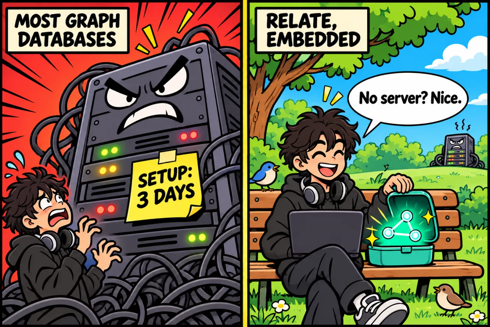</a></p>

The graph runs on [Relate](https://github.com/relatedb/relate), an open-source
embedded graph database written in Rust. Tracetoon ships it compiled to
WebAssembly (`assets/relate.wasm`) inside the CLI.

- **No server, no setup.** It runs in-process on Linux, macOS and Windows, with
  no native modules and no database file. It works offline and builds a fresh
  graph for every PR. If it can't start, the digest is still written.
- **Real queries, not guesswork.** A few lines of Cypher answer questions like
  "which request led to this code?" and "did a test pass after the last edit?"
- **Search links.** A BM25 FULLTEXT index over each hunk's path, symbols and
  lines ties commit sentences, requests and plans to the hunks they describe. A
  link is kept only when an exact name or path agrees, or when one file clearly
  leads. Turn it off with `prepare --graph-search none`.
- **Same evidence in, same brief out.** Every fact traces back to a hunk and a
  session line, so you, or another agent, can audit any sentence.

> [!NOTE]
> **0 tokens** to build the graph and the evidence brief. It's a deterministic
> step, not a model call. Relate is the open-source successor of cypherlite,
> which earlier releases embedded. `TRACETOON_RELATE_WASM` points at a different
> build; `TRACETOON_CYPHERLITE_WASM` still works as a deprecated alias.

---

## 💸 Cost: a sharp brief lets cheap workers check the work

<p align="center"><a href="https://tracetoon.com/#cost">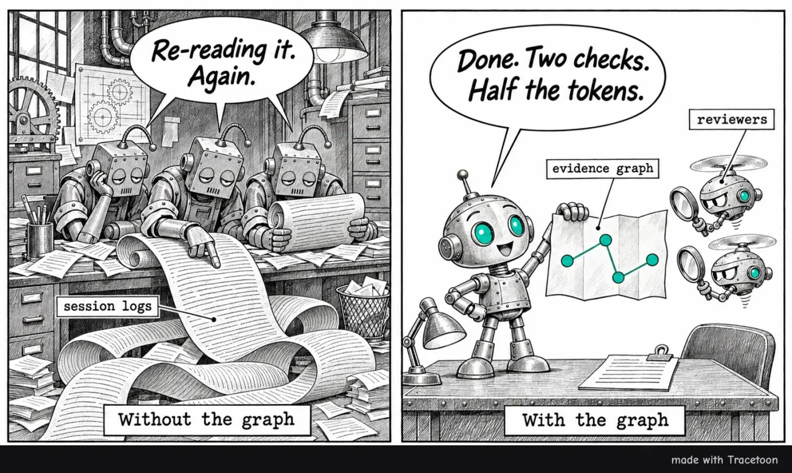</a></p>

Without a map, an expensive model rereads your source to check its own claims,
two or three times per PR. With the graph, that work is done once, before any
model runs. Then:

1. **One strong writer** drafts from a 2–3K-token brief instead of the whole
   session history, and writes about 7K tokens instead of 22K.
2. **Two cheap reviewers** check a short packet in parallel: one with the
   completeness lens, one general. They run on the host's cheap model at
   `xhigh` effort (`haiku` subagents on Claude Code, `luna` passes started by
   `tracetoon review run` on Codex). That's about 4¢ per PR on Claude and
   under 1¢ on Codex.
3. **One edit pass.** The reviewers' findings merge into a single list. There
   are no repeat review rounds, and `publish` refuses until both passes are
   imported.

| Setup              | Cost per PR |
| ------------------ | ----------: |
| Claude, no graph   |       $0.69 |
| **Claude + graph** |   **$0.41** |
| Codex, no graph    |       $0.32 |
| **Codex + graph**  |   **$0.21** |

<details>
<summary><b>Tuning the review plan</b></summary>

The defaults are the variant lines at the end of the Workflow section in the
skill's [`SKILL.md`](plugin/skills/tracetoon/SKILL.md). `tracetoon prepare`
takes a matching flag for each:

| `SKILL.md` line           | `prepare` flag      | Values                                                    |
| ------------------------- | ------------------- | --------------------------------------------------------- |
| `Reviewer model: cheap.`  | `--reviewer-model`  | `cheap`, a model name, or `same`                          |
| `Reviewer effort: xhigh.` | `--reviewer-effort` | `low`, `medium`, `high`, `xhigh`, `max`, `default`        |
| `Review passes: 2.`       | `--review-passes`   | number of fresh reviewer passes `publish` requires        |
| `Review lenses: d.`       | `--review-lenses`   | lenses `a`–`d` or `none`; one pass per lens               |
| `Reviewer runner: auto.`  | `--reviewer-runner` | `agent` (drafter starts it) or `tracetoon` (`review run`) |
| `Review recheck: none.`   | `--review-recheck`  | `once`, `contested` or `none`                             |
| `Brief layout: toon.`     | `--layout`          | `toon`, `neighborhood`, `neighborhood-wide`               |
| `Graph search: fulltext.` | `--graph-search`    | `fulltext` (`bm25`) or `none`                             |

On an unknown host, reviewers use the main agent's model and the agent starts
them. The graph doesn't turn a small model into a mid-size one: Haiku as the
_writer_ still lost. The win comes from a strong writer plus cheap checkers.

</details>

---

## 🎨 Comics: a comic nobody asked for. Everyone reads it.

<p align="center"><a href="https://github.com/Tracetoon/tracetoon/pull/17">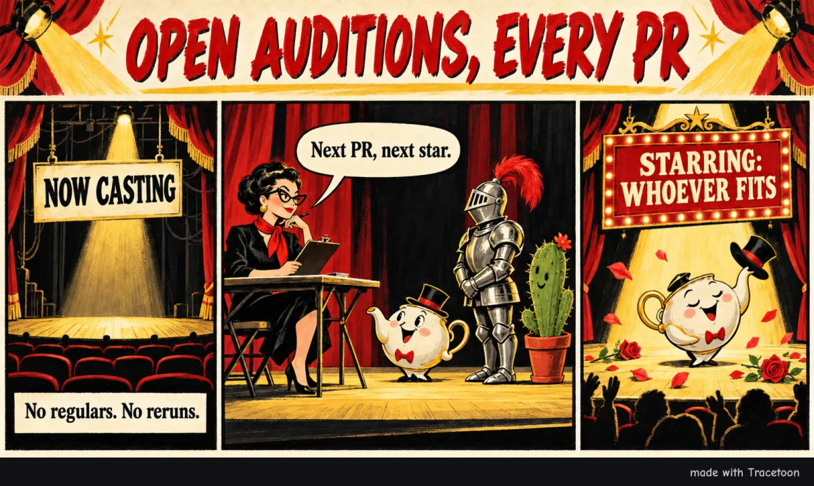</a><br><sub>The comic Tracetoon made for <a href="https://github.com/Tracetoon/tracetoon/pull/17">PR #17</a>, which removed the old recurring cast.</sub></p>

Each PR can get a one-off comic: a joke about how the work really went, with
characters, a format and an art style made up for that PR. There are no
mascots and no recurring cast.

- **Formats.** A gag strip, a before and after, a movie poster, an instruction
  manual and more. The drafter compares three short story, layout and cast
  concepts before one is drawn. Composition follows the joke: a single visual
  metaphor, a two-panel comparison, a vertical pause, unequal frames, insets or
  a diagonal split.
- **Fresh every time.** Tracetoon reads compact metadata from the repo's recent
  comics (style family, layout, panel count, cast categories) and picks
  something different. Pin a style with `tracetoon config set style "<idea>"`.
- **Proofread.** An image model you choose draws the whole page, lettering
  included. `comic render` prints every word for the agent to proofread, and
  adds a small "made with Tracetoon" footer bar.
- **It respects the repo.** Where contributing rules forbid images in PRs,
  Tracetoon skips the comic and tells you why. `comic always` overrides that;
  `comic off` turns comics off.
- **Never a blocker.** Without an approved image route, or if drawing fails,
  the PR is created without a comic, and the message after the PR says why.

### Set up an image route

Run `tracetoon images` to see which routes are on your machine, whether each can
draw, and what to do next. Approve one and check it really draws, using one
small test picture with no repo content:

```sh
tracetoon images                          # what's available and approved
tracetoon images --approve codex --test   # approve a route and draw a test image
```

Your agent offers the same at the start of your first PR. `comic art` uses the
first approved route that can draw, in this order:

| Route                        | Needs                                                                                                       | Prompts go to                                  |
| ---------------------------- | ----------------------------------------------------------------------------------------------------------- | ---------------------------------------------- |
| `codex` (recommended)        | the Codex CLI, signed in with ChatGPT (`codex login`)                                                       | OpenAI, counted against your Codex usage       |
| `antigravity` (experimental) | the Antigravity CLI, signed in                                                                              | Google, counted against your Antigravity quota |
| `openai`                     | `OPENAI_API_KEY` (model `gpt-image-2.5-flare`, change with `TRACETOON_OPENAI_MODEL`)                        | OpenAI, billed to your key                     |
| `gemini`                     | `GEMINI_API_KEY` or `GOOGLE_API_KEY` (model `gemini-nano-banana-2.1`, change with `TRACETOON_GEMINI_MODEL`) | Google, billed to your key                     |

A Codex set up for another model provider in `~/.codex/config.toml` (a LiteLLM
proxy, say) has no image tool. After setting an API key, restart your agent so
it sees the key: on Windows, `setx OPENAI_API_KEY "<key>"`; on macOS or Linux,
add `export OPENAI_API_KEY="<key>"` to your shell profile.

> [!IMPORTANT]
> Prompts contain only the comic's scenes and character descriptions, never code
> or log text. Nothing is sent until you approve a route, and only you can
> approve one: a repo's `.github/tracetoon.json` can't. To stop using a route,
> remove it with `tracetoon config set imageConsent <list>`, or turn a CLI route
> off with `TRACETOON_CODEX_BIN=none` or `TRACETOON_AGY_BIN=none`.

---

## 🤝 Fits your workflow: it knows the house rules

<p align="center"><a href="https://tracetoon.com/#control">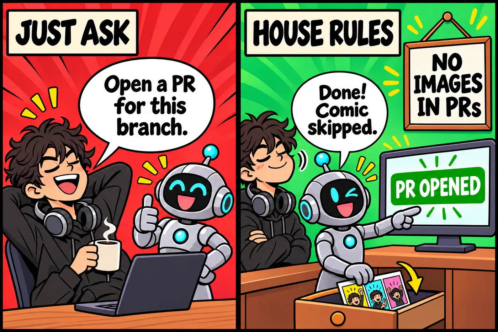</a></p>

- **Nothing new to learn.** Ask for a PR, or let your agent run `gh pr create`.
  There is no preview or approval step: the agent prepares the PR, has it
  reviewed, creates it, and tells you what it did. Finishing a task never opens
  a PR on its own, and `publish` never merges.
- **Follows the house rules.** Tracetoon reads each repo's AI policies,
  `AGENTS.md`, PR templates and contribution guides. It adds any disclosure the
  repo asks for, and it reports any policy against AI contributions (your
  request for the PR is the override).
- **Private by default.** Logs are read on your machine. Secrets, personal data,
  your home path and your username are redacted from the evidence. Only the
  rendered PR text and the comic are published.

### The PR hook

The installer adds a small hook to each agent. When an agent tries to open a PR,
or rewrite a PR's title or body, the hook points it to Tracetoon instead.

| Redirected to Tracetoon                                                                    | Left alone                                                                         |
| ------------------------------------------------------------------------------------------ | ---------------------------------------------------------------------------------- |
| `gh pr create`, `gh pr edit` and gh aliases for them                                       | `git push` (branches for CI, tags, release commits)                                |
| `hub pull-request`, git-extras `git pull-request`, Git Town `git town propose`             | Stacking tools: Graphite, git-spice                                                |
| Writes to GitHub's pulls API through `gh api`, `hub api`, curl, wget, HTTPie or PowerShell | API reads, state-only changes (closing a PR), other forges                         |
| GraphQL `createPullRequest`, and the GitHub connector tools agents use                     | Calls made inside a script, or a GraphQL mutation read from a file (can't be seen) |

The hook only touches its own entries in each agent's config, backs up each file
before the first change, and lists every file it changed. If a PR command was
redirected, the agent's stop hook keeps it from finishing until that PR is
published, so a redirected PR isn't left behind. Codex asks you to trust a new
hook once (`/hooks`); the Antigravity IDE picks it up after a restart. Skip
installing it with `TRACETOON_NO_HOOK=1`, or manage it with
`tracetoon hook install` and `tracetoon hook uninstall`.

### Turn it off at whichever level you need

Any "off" wins:

| Scope                   | Off                                                                 | On again               |
| ----------------------- | ------------------------------------------------------------------- | ---------------------- |
| One command             | `TRACETOON=0 gh pr create ...`                                      | (just once)            |
| You, everywhere         | `tracetoon off`                                                     | `tracetoon on`         |
| This repo, for everyone | `tracetoon off --repo` (writes `.github/tracetoon.json`; commit it) | `tracetoon on --repo`  |
| This repo, just you     | `tracetoon off --local` (git config)                                | `tracetoon on --local` |
| CI                      | off automatically when `CI=true`                                    | `TRACETOON=1`          |

`tracetoon status` shows whether it's on here and which setting decided.

---

## 🔧 Under the hood: from session logs to a reviewed PR

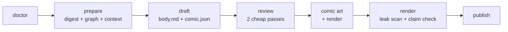

Your agent drives these steps from the skill; you normally never type them. Each
run lives in `.git/tracetoon/runs/<id>/`, which git never tracks. The newest 20
scratch runs are kept. Every command takes `--json`.

<details>
<summary><b>1. <code>tracetoon doctor</code>: can this machine make a PR?</b></summary>

Checks git and gh, whether you can push to the repo, which agent logs are on the
machine, and whether a comic can be drawn. `--json` also reports the actual
runtime and hook identities, installed skill mismatches and observed hook
events. `doctor --probe` lists log record types the readers don't recognize, so
format drift shows up early (`--strict` exits 5 if any are found).

</details>

<details>
<summary><b>2. <code>tracetoon prepare</code>: digest, evidence graph and context from one snapshot</b></summary>

`prepare` runs `digest` and `context` against one repository snapshot.

**Digest.** It reads the branch from git (base, commits, the exact lines added)
and finds the agent sessions behind it. The evidence is:

- edits whose lines are still in the diff
- commits made during a session, including from worktrees since deleted
- PR links, the branch, timing and the working folder

It keeps your prompts, plans, decisions and each verification run, with how that
run relates to later edits. Everything is redacted. Sessions that may not belong
to the PR are left out and counted in the final message; use `--include` or
`--exclude` to override, and `tracetoon scan` to see every candidate session with
its score. `--base <remote>/<branch>` targets a base only another remote has.
`--budget` sets the digest size.

**Graph.** It builds `evidence-graph.json` and loads it into Relate, as described
[above](#%EF%B8%8F-evidence-graph-every-sentence-has-a-receipt).

**Context.** It reads the PR template, AI policies and agent instructions, any
existing PR (and edits made to it on GitHub), your settings, and the art styles
of the repo's recent comics. It also prepares a contributor-research packet and
the submitted diff. `--offline` disables GitHub lookups and leaves external
references as collection gaps.

If the repo already records provenance with [Entire](https://entire.io)
checkpoints or git-ai notes, the digest says so.

</details>

<details>
<summary><b>3. Draft and review: one strong writer, two cheap checkers</b></summary>

Your agent writes `body.md` itself from `tracetoon query brief` and the patch,
and writes the comic brief `comic.json`. Two fresh reviewers then check it, as
described in [Cost](#-cost-a-sharp-brief-lets-cheap-workers-check-the-work).
`tracetoon review run` starts pinned-model passes where the host supports it;
`review import` and `review merge` record and combine their findings.

When you ask for the most thorough PR, or there is no brief, your agent instead
coordinates a **researcher** and a separate **drafter**. The researcher collects
applicable local and linked guidelines, scoped instructions, conditions and
exceptions, and `tracetoon guidance check` validates that handoff. The drafter
receives the guidance, redacted traces and submitted code. Role prompts and the
versioned `guidance.json` and `review.json` contracts are in the
[contribution workflow](plugin/skills/tracetoon/references/contribution-workflow.md).

These roles use the host's native subagents, with no other model API or
credentials. Hosts without delegation use a clearly labeled inline draft and
self-review. Role identity is reported by the host, not certified by the CLI.

</details>

<details>
<summary><b>4. <code>tracetoon comic art</code> / <code>comic render</code>: draw and letter the page</b></summary>

`comic check` validates `comic.json` before any art is made. `comic art` draws
the page with your approved route (`--provider` picks one). `comic render` lays
out the page and prints the words to proofread. `comic reroll` redraws with a
new format that respects the story's panel count, and `comic prompts` prints
prompts for the host agent's own image tool. Changing the script or its
`composition` invalidates cached art and rendered output. The
[art-direction guide](plugin/skills/tracetoon/references/comic-direction.md)
links the manga and joke-comic research behind these choices.

</details>

<details>
<summary><b>5. <code>tracetoon render</code>: freeze, scan and check</b></summary>

Builds the final body inside Tracetoon's marked region, so your own text is
kept. Then it runs the **leak scan** and the **claim check**, lists optional
notes, and prepares the exact rendered PR for the reviewers. Re-rendering shows
current findings, source citations, collection gaps and missing evidence.
Changed inputs invalidate old reviews.

A possible secret found by the leak scan stops posting until the text is
rewritten, or until you say the finding is fine (`--allow-findings`).
`--no-comic` leaves the comic out; `--retitle` replaces a title a person chose,
and only after you agree.

</details>

<details>
<summary><b>6. <code>tracetoon publish</code>: post exactly what was rendered</b></summary>

Posts the rendered PR right away. The comic goes on the repo's
`tracetoon-assets` branch, or as a GitHub attachment for private repos
(`--hosting auto|branch|attach`). Then `gh` creates or updates the PR in one
resolved target repo, which also works from forks.

- The branch is pushed if necessary. `--no-push` requires it to already be on
  the remote at the rendered commit.
- `--draft` opens a draft PR.
- Network retries reconcile an existing PR before creating a new one.
- The GitHub URL comes back without waiting for CI.

**Nothing is posted from an old render.** New commits or working-tree changes
need a fresh `prepare` and `render`; commit working-tree changes first.

</details>

<details>
<summary><b>Optional bookkeeping: <code>task</code> and <code>check</code></b></summary>

Hooks observe session and repository metadata locally. They don't inject
startup rules or require registration, branch changes or wrapped tests.

For explicit evidence receipts, `tracetoon check --run <id> --name <name> -- <command>`
runs a validation command and records the exact content it tested. Output
streams to stderr while it runs; stdout gets the final receipt. An interrupted
check doesn't count as a pass. `--skip "<reason>"` records a check deliberately
left to CI. `task begin`, `task complete`, `task defer` and `task block` track a
cohesive local change. All of this is optional.

`tracetoon export --agent-trace` writes the PR's line attribution as an
[Agent Trace](https://agent-trace.dev) record.

</details>

---

## 📥 Install, update, uninstall

<p align="center">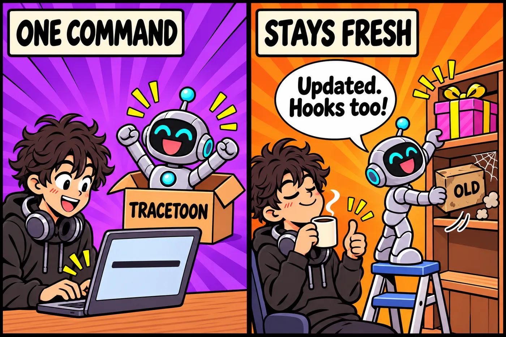</p>

The installer puts a `tracetoon` command on your PATH and installs the skill and
PR hook for every supported agent it finds. It ends with a line about comics:
which image route it found and what to do next. Downloads are checked against
the release's SHA-256 checksums.

**Update.** Ask your agent _"Update Tracetoon."_, or run it yourself:

```sh
tracetoon update                          # install the latest release in place
tracetoon update --check                  # only report; add --exit-code to exit 10 when newer exists
tracetoon update --channel stable         # ignore release candidates
tracetoon update --to 1.0.0-rc.24         # a specific release (also how to roll back)
```

`update` downloads the release and checks it against the checksums. It confirms
the skill and runtime are one build, then replaces the binary, comic assets,
every installed skill copy and the hooks together. If any step fails, it
restores the old files. Afterwards, reload your agent; Codex may ask you to
trust the new hook entries in `/hooks`.

- `tracetoon config set autoUpdate off|notify|install` controls the session
  notice and background installs (default `notify`).
- `tracetoon config set updateChannel stable|latest` picks the channel (default
  `latest`, which includes release candidates).
- `TRACETOON_DISABLE_UPDATES=1` blocks `update` entirely.
- Re-running the installer also updates.
- `update` can't replace a Claude Code plugin or a source checkout in place: the
  plugin updates with `/plugin marketplace update tracetoon`, a checkout with
  `git pull`. Asking your agent to update tells you which applies.

**Uninstall.** Set `TRACETOON_UNINSTALL=1` and run the installer again.

<details>
<summary><b>Other ways to install</b></summary>

- **Claude Code plugin:** `/plugin marketplace add Tracetoon/tracetoon`, then
  `/plugin install tracetoon@tracetoon`. The plugin comes from the `release`
  branch, which carries each published release with its built bundle; `main` has
  only source. Update it with `/plugin marketplace update tracetoon`, or turn on
  auto-update under `/plugin` > Marketplaces (third-party marketplaces start
  with it off), then run `/reload-plugins`. The plugin runs its bundled copy
  under Bun or Node 22+. For the prebuilt binary and the PR hook, run the
  installer once; after that, `tracetoon update` keeps everything in step and
  `tracetoon doctor` flags any copy that falls out of step.
- **By hand:** unzip `tracetoon-skill.zip`, or a per-platform
  `tracetoon-skill-<os>-<arch>.zip` that includes the binary, from a
  [release](https://github.com/Tracetoon/tracetoon/releases) into your agent's
  skills folder:

  | Agent         | Folder                                                               |
  | ------------- | -------------------------------------------------------------------- |
  | Claude Code   | `~/.claude/skills/tracetoon`                                         |
  | Codex         | `~/.agents/skills/tracetoon` (or `.agents/skills/` in a repo)        |
  | Antigravity   | `~/.gemini/config/skills/tracetoon` (or `.agents/skills/` in a repo) |
  | Factory Droid | `~/.agents/skills/tracetoon` (shared with Codex)                     |
  | Copilot       | `~/.agents/skills/tracetoon` (shared with Codex)                     |
  | Gemini CLI    | `~/.gemini/skills/tracetoon`                                         |

- **From source:** see [Contributing](#-contributing-ai-welcome-comics-wanted).
  A source checkout updates with `git pull`.

**The launcher.** The skill ships `bin/tracetoon` (plus `.cmd` and `.ps1`). It
uses, in order: a binary next to it, the installed binary, Bun, or Node 22+ with
the bundled `dist/tracetoon.mjs`. With your permission it can instead download
the release binary and verify its checksum.

</details>

---

## ⚙️ Reference

<details>
<summary><b>Settings</b></summary>

`tracetoon config get [key]` and `tracetoon config set <key> <value>` manage your
user config in `~/.config/tracetoon/config.json` (`%APPDATA%\tracetoon` on
Windows; override with `TRACETOON_CONFIG`). A repo can set shared defaults in
`.github/tracetoon.json`. Settings marked _user only_ are ignored there.

| Key             | Default       | Meaning                                                                                                   |
| --------------- | ------------- | --------------------------------------------------------------------------------------------------------- |
| `enabled`       | `true`        | Use Tracetoon for PRs (also `tracetoon on`/`off`)                                                         |
| `comic`         | `allowed`     | `off`, `allowed` (unless the repo forbids images in PRs) or `always`. `true`/`false` mean `allowed`/`off` |
| `style`         | `auto`        | Pin one art style for every comic (an idea from `references/styles.md` or any description)                |
| `promptQuoting` | `paraphrase`  | `verbatim` quotes your prompts in the PR                                                                  |
| `disclosure`    | `assisted-by` | Disclosure style (a repo's AI policy can ask for another)                                                 |
| `hosting`       | `auto`        | Where the comic goes: `branch`, `attach` or `auto`                                                        |
| `budgetTokens`  | `12000`       | Digest size                                                                                               |
| `imageConsent`  | `[]`          | Image routes you approved (set by `tracetoon images --approve`). _User only_                              |
| `autoUpdate`    | `notify`      | `off`, `notify` or `install` (background installs). _User only_                                           |
| `updateChannel` | `latest`      | `latest` (includes release candidates) or `stable`. _User only_                                           |

</details>

<details>
<summary><b>Commands</b></summary>

| Stage    | Command                                                 | What it does                                                          |
| -------- | ------------------------------------------------------- | --------------------------------------------------------------------- |
| Setup    | `doctor`                                                | git, gh, push access, agent logs, image routes, runtime/hook identity |
|          | `images`                                                | image routes: available, approved, `--approve`, `--test`              |
|          | `update`                                                | check for and install a newer release in place                        |
|          | `status`, `on`, `off`                                   | whether Tracetoon handles PRs here, and switches                      |
|          | `hook install` / `uninstall`                            | the agent PR hook                                                     |
|          | `config get` / `set`                                    | settings                                                              |
| Evidence | `scan`                                                  | sessions that match this branch, with scores                          |
|          | `prepare`                                               | digest + graph + context from one snapshot                            |
|          | `digest`, `context`                                     | the two halves of `prepare`                                           |
|          | `query`                                                 | ask the evidence graph (named queries or `--cypher`)                  |
|          | `expand <refs>`                                         | full redacted evidence for a session, fact or `commit:<sha>`          |
|          | `source <paths>`                                        | snapshot base/head files as immutable review references               |
|          | `guidance check`                                        | validate the researcher's `guidance.json`                             |
| Review   | `review run` / `import` / `merge`, `review-packet`      | reviewer passes and their findings                                    |
| Comic    | `comic check` / `art` / `render` / `reroll` / `prompts` | make this PR's comic                                                  |
| Ship     | `render`                                                | freeze `body.md`, leak scan, claim check                              |
|          | `publish`                                               | create or update the PR with exactly what was rendered                |
| Extras   | `check`, `task`                                         | optional validation receipts and change bookkeeping                   |
|          | `export --agent-trace`                                  | Agent Trace line attribution                                          |
|          | `build-info`                                            | runtime identity and capabilities                                     |

Run `tracetoon <command> --help` for every flag.

</details>

<details>
<summary><b>Environment variables</b></summary>

| Variable                                             | Effect                                                        |
| ---------------------------------------------------- | ------------------------------------------------------------- |
| `TRACETOON=0` / `TRACETOON=1`                        | Off for one command / on in CI                                |
| `TRACETOON_NO_HOOK=1`                                | Installer skips the PR hook                                   |
| `TRACETOON_UNINSTALL=1`                              | Installer removes Tracetoon                                   |
| `TRACETOON_DISABLE_UPDATES=1`                        | Blocks `tracetoon update`                                     |
| `TRACETOON_CONFIG`                                   | Path of the user config file                                  |
| `TRACETOON_OPENAI_MODEL`, `TRACETOON_GEMINI_MODEL`   | Image model for the API routes                                |
| `TRACETOON_CODEX_BIN`, `TRACETOON_AGY_BIN`           | Path to the Codex or Antigravity CLI, or `none` to disable it |
| `TRACETOON_RELATE_WASM`                              | A different Relate WebAssembly build                          |
| `OPENAI_API_KEY`, `GEMINI_API_KEY`, `GOOGLE_API_KEY` | Keys for the API image routes                                 |

</details>

---

## 🎤 Watch the talk

<p align="center"><a href="https://www.youtube.com/watch?v=gbeuC0ud1p4"></a></p>

**"Your PR says the tests passed. Prove it."** At AI Engineer, Stephen Chin and
Cassandra Chin explain why agent-written PRs need receipts, and how Tracetoon
gets them from the session logs.

---

## 🙌 Contributing: AI welcome. Comics wanted.

<p align="center">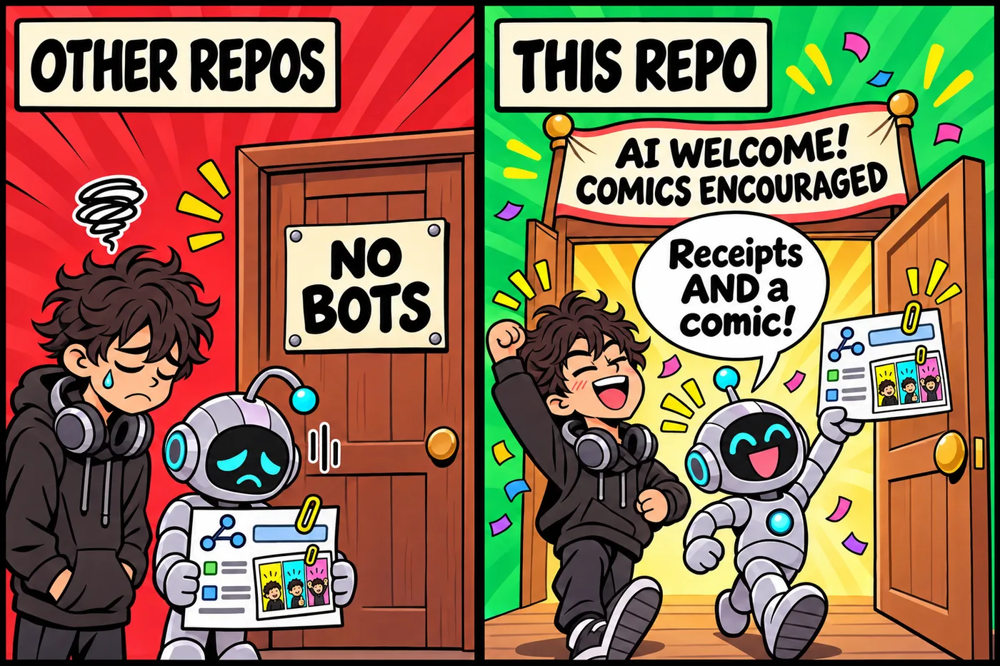</p>

> [!IMPORTANT]
> **AI-assisted and agent-written contributions are allowed here. Use whatever
> agent you like.**
>
> **We strongly encourage opening your PR with Tracetoon**, so it ships with
> receipts and a comic. It's the best way to show us what you asked for, what
> ran and what changed, and we love reading the comics.

You stay responsible for what you submit: read the diff, and let the evidence
speak for the tests.

```sh
git clone https://github.com/Tracetoon/tracetoon && cd tracetoon
bun run dependencies:prepare   # locked Showtail source from build-dependencies.json
bun install --frozen-lockfile
bun run typecheck && bun run test
bun src/cli.ts doctor          # run straight from source; nothing to build first
```

Then ask your agent: _"Open a PR for this branch with Tracetoon."_

- Use Bun 1.3.14, as pinned in `build.config.json` and CI.
- Never commit real session logs. Fixtures are synthetic or scrubbed.
- The packaged suites (`test:bundled`, `test:compiled`) run on every PR in CI.
  Locally they're optional; record them as left to CI rather than as passed.
- The bundle is not committed: `bun run bundle` builds it for packaged runs, and
  the release workflow publishes it on the `release` branch.

[CONTRIBUTING.md](CONTRIBUTING.md) has the code layout, how to add an agent,
evaluation scripts, the Relate WebAssembly pin and the release process.

---

<p align="center">
<a href="https://tracetoon.com">tracetoon.com</a> ·
<a href="https://tracetoon.com/evidence-graph.html">Evidence graph results</a> ·
<a href="https://github.com/relatedb/relate">Built on Relate</a> ·
<a href="https://github.com/Tingsters/Showtail/tree/main/packages/agent-traces"><code>@showtail/agent-traces</code></a>
</p>

<p align="center"><sub>Apache-2.0. The bundled Comic Neue font is under the SIL
Open Font License (<code>plugin/skills/tracetoon/assets/fonts/OFL.txt</code>).
Tracetoon builds on <code>@showtail/agent-traces</code>, the log readers and
redaction shared with <a href="https://github.com/Tingsters/Showtail">Showtail</a>.</sub></p>
