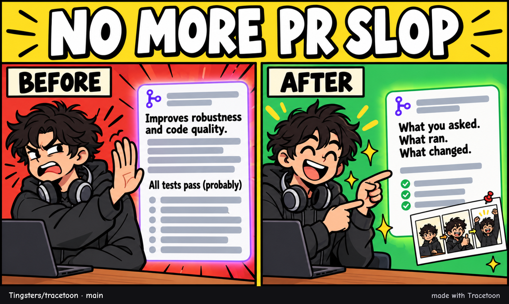
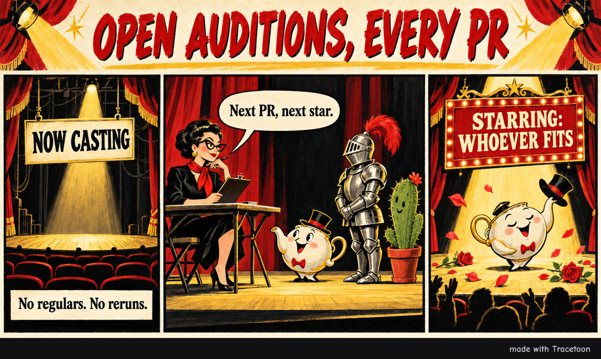

# Tracetoon

<p align="center"></p>

**AI-written pull requests are mostly slop:** vague, padded, and confident
about tests nobody saw pass. Tracetoon writes the PR from what actually
happened in your agent sessions (your prompts, the plan, the decisions, the
commands that ran), and adds a comic of the story that people want to read.
You see the exact text and comic, and approve them, before anything is posted.

## Better PRs

The sessions behind your branch are already on your machine: Claude Code, Codex
and Antigravity keep their logs. Tracetoon finds the ones that produced this
branch and turns them into a redacted digest your agent writes from.

- **Written from evidence.** What you asked for, the plan you approved, the
  decisions you made, and every test, build and lint run with its result. No
  invented motivation, and no "all tests pass" unless a run showed it.
- **Honest about what's known.** A run that passed before the last edits is
  described that way. Something that wasn't captured is "not captured", not
  "not done".
- **Short and reviewable.** The problem and the result first, the reason for
  the approach, what was checked, and where to start reviewing. No
  file-by-file lists or test-count inventories.
- **Checked before you post.** An advisory claim check marks sentences the
  evidence contradicts or doesn't establish, right beside them in the preview.
  It also works on text you wrote yourself.
- **Optional notes, never a form.** Next to the draft, Tracetoon lists what a
  reviewer may want that the logs don't show (a manual check, the reason for a
  choice). Add them or skip them.
- **Your words stay yours.** Text you write in the PR, or edit on GitHub later,
  is kept on the next update.
- **Follows the repo's rules.** It reads AI policies, `AGENTS.md`, PR templates
  and contribution guides. It adds the disclosure a repo asks for, leaves the
  comic out where AI images aren't allowed, and won't open a PR where agents
  are told not to.

In a test on 8 real PRs, drafts written this way had no factual errors (the
original descriptions had 10) and 2 unsupported claims instead of 34, at about
three quarters of the length. A blind judge preferred them in all 8 cases. They
covered a little less background (76% vs 81% of the key context). The judges
were AI models and the sample is small, so read these as development numbers.

## Comics

Every PR gets a one-off comic: a joke about how the work really went, with
characters and an art style made up for that PR. There are no mascots and no
recurring cast. The agent picks a format (a gag strip, a before/after, a movie
poster, an instruction manual and more) and any art style that differs from the
repo's recent comics. An image model you choose draws the whole page, lettering
included, and the agent proofreads every word.

<p align="center"><a href="https://github.com/Tingsters/tracetoon/pull/17"></a><br><sub>The comic Tracetoon made for <a href="https://github.com/Tingsters/tracetoon/pull/17">PR #17</a>, which removed the old recurring cast.</sub></p>

Comics are optional. Without an image route, or with `tracetoon config set
comic false`, the PR simply has none.

## Install

One command installs Tracetoon for every agent on your machine, with a prebuilt
binary, so nothing else is needed:

```sh
# macOS, Linux, Git Bash
curl -fsSL https://raw.githubusercontent.com/Tingsters/tracetoon/main/install.sh | sh
```

```powershell
# Windows PowerShell
irm https://raw.githubusercontent.com/Tingsters/tracetoon/main/install.ps1 | iex
```

The installer puts a `tracetoon` command on your PATH and ends with a line about
comics: which image route it found and what to do next. Restart your agent,
then in any repo with your work on a branch, ask:
*"Open a PR for this branch with Tracetoon."*

| Agent | Status |
|---|---|
| Claude Code | supported |
| Codex (CLI and app) | supported |
| Antigravity (CLI and IDE) | supported |
| Gemini CLI | runs the skill (its own logs aren't read yet) |
| Copilot CLI | planned |

Re-run the command to update. To remove, set `TRACETOON_UNINSTALL=1` and run it
again. Downloads are checked against the release's SHA-256 checksums.
After an update, reload your host; Codex may require trusting the new entries
in `/hooks`. `tracetoon doctor --json` distinguishes configured hooks, observed
handler invocations, and mismatched runtimes. Missing completion hooks mean
automatic preparation is not active, even if the older PR-command hook exists.

### Set up comics

Run `tracetoon images` to see which image routes are on your machine, whether
each can draw, and what to do next:

- **Codex CLI** (recommended if you have ChatGPT): install it and run
  `codex login` with your ChatGPT account. Images count toward your plan's
  Codex usage; no key needed. A Codex set up for another model provider (in
  `~/.codex/config.toml`, such as a LiteLLM proxy) has no image tool.
- **Antigravity CLI** (experimental): signed in, it uses your Antigravity quota.
- **OpenAI or Gemini API**: set `OPENAI_API_KEY` or `GEMINI_API_KEY`, billed
  per image to your key. On Windows run `setx OPENAI_API_KEY "<key>"`; on macOS
  or Linux add `export OPENAI_API_KEY="<key>"` to your shell profile. Then
  restart your agent so it sees the key.

Approve one and check it really draws (one small test picture, no repo content):
`tracetoon images --approve codex --test`. Your agent offers the same at the
start of your first PR.

### Tracetoon is the default for PRs, and easy to turn off

The installer adds a small hook to each agent. When an agent tries to open a PR
with `gh pr create` (or rewrite one with `gh pr edit --title/--body`), the hook
points it to Tracetoon, so you always get a preview first. It only touches its
own entries in each agent's config, backs up each file before the first change,
and lists every file it changed. Skip it with `TRACETOON_NO_HOOK=1`. Codex asks
you to trust a new hook once (`/hooks`), and the Antigravity IDE picks it up
after a restart.

Turn it off at whichever level you need. Any "off" wins:

| Scope | Off | On again |
|---|---|---|
| One command | `TRACETOON=0 gh pr create ...` | (just once) |
| You, everywhere | `tracetoon off` | `tracetoon on` |
| This repo, for everyone | `tracetoon off --repo` (writes `.github/tracetoon.json`; commit it) | `tracetoon on --repo` |
| This repo, just you | `tracetoon off --local` (git config) | `tracetoon on --local` |
| CI | off automatically when `CI=true` | `TRACETOON=1` |

`tracetoon status` shows whether it's on here and which setting decided.

<details>
<summary>Other ways to install</summary>

- **Claude Code plugin:** `/plugin marketplace add Tingsters/tracetoon`, then
  `/plugin install tracetoon@tracetoon`.
- **By hand:** unzip `tracetoon-skill.zip` (or a per-platform
  `tracetoon-skill-<os>-<arch>.zip`, which includes the binary) from a
  [release](https://github.com/Tingsters/tracetoon/releases) into your agent's
  skills folder:

| Agent | Folder |
|---|---|
| Claude Code | `~/.claude/skills/tracetoon` |
| Codex | `~/.agents/skills/tracetoon` (or `.agents/skills/` in a repo) |
| Antigravity | `~/.gemini/config/skills/tracetoon` (or `.agents/skills/` in a repo) |
| Gemini CLI | `~/.gemini/skills/tracetoon` |

</details>

## How it works

When a cohesive coding change is finished, the agent prepares a local Tracetoon
automatically. You do not need to remember to ask for a PR. Planning, questions
and unfinished work stay in progress; refinements update the same unpublished
draft. If another PR is awaiting review, its reminder and link remain available.

Local checks finish before the author handoff. Open the prominent preview link,
skim the description and comic, and reply **"Publish this PR"**. That approval
covers pushing the approved branch, hosting its comic, and creating/updating the
PR. The GitHub URL is returned without waiting for remote CI. Merging is separate.

The host uses `task begin`, `check`, `task complete`, and `ready` to track these
steps. Completed checks are tied to their tested content and environment, so
unchanged approval does not repeat tests or regenerate the comic. CI-only checks,
failures and unavailable evidence stay visible. `task defer --reason` records
unfinished work; `task block --reason` records a preparation problem.

1. **`tracetoon doctor`** checks git and gh, whether you can push to the repo,
   and whether a comic can be drawn, before any work starts.
2. **`tracetoon digest`** reads the branch from git (base, commits, the exact
   lines added) and finds the agent sessions behind it. The evidence: edits
   whose lines are still in the diff, commits made during a session (including
   from worktrees since deleted), PR links, the branch, timing and working
   folder. It keeps your prompts, plans, decisions and each verification run,
   with how that run relates to later edits. Everything is redacted: secrets,
   personal data, your home path and username.
3. **`tracetoon context`** reads the PR template, AI policies and agent
   instructions, any existing PR (and edits made to it on GitHub), your
   settings, and the art styles of the repo's recent comics. It also prepares
   a contributor-research packet and the submitted diff.
4. **Your agent coordinates a researcher and a drafter.** The researcher collects
   applicable local and linked guidelines, scoped instructions, conditions and
   exceptions. `tracetoon guidance check` validates that handoff. A separate
   drafter receives the guidance, redacted traces and submitted code, then writes
   the description (`body.md`) and comic brief (`comic.json`).
5. **`tracetoon comic art` / `comic render`** draw the page with the image
   route you approved, add a small "made with Tracetoon" footer bar, and print
   the words to proofread.
   The drafter first compares three short story/layout/cast concepts, then draws
   one image. Composition follows the joke: a single visual metaphor, a two-panel
   comparison, a vertical pause, unequal frames, insets or a diagonal split.
   Visible titles are optional. Fictional people, useful creature/object
   metaphors and characterless scenes are all available; there is no animal cast
   default or fixed rotation.
6. **`tracetoon render`** builds the final body (Tracetoon only owns a marked
   region, so your own text is kept), runs the leak scan and the claim check,
   lists optional notes, and prepares the exact rendered PR for an independent
   reviewer. The reviewer checks adherence against the original guidance and
   evidence; the drafter gets up to two correction rounds. Re-rendering shows
   current findings, source citations, collection gaps and missing evidence in
   the preview. Changed inputs invalidate old reviews. Reviews are advisory;
   existing publishing restrictions still apply.
7. **`tracetoon ready --run <id> --serve`**, then open the local preview using the linked label under the compact
   Tracetoon logo at the end of the output. Skim the description and comic,
   then tell your agent "Publish this PR". The note below the link explains
   how to enable YOLO for future PRs if you prefer to skip that pause.
8. **`tracetoon publish --code <code>`** posts exactly what you approved: the
   comic goes on the repo's `tracetoon-assets` branch (or as a GitHub
   attachment for private repos), and `gh` creates or updates the PR. The approved
   branch is pushed automatically if necessary; `--no-push` requires it to already
   be on the remote. Network retries reconcile an existing PR before creating one.

Other commands: `images`, `status`, `on`/`off`, `hook install`/`uninstall`,
`scan`, `expand`, `preview`, `pending dismiss --run <id>`, `comic prompts`/`reroll`, `export --agent-trace`
([Agent Trace](https://agent-trace.dev) line attribution), `config`. Every
command takes `--json`.

These roles use the current host's native subagents, without another model API
or credentials. Hosts without delegation use a clearly labeled inline draft and
self-review. `context --offline` disables GitHub lookups and tells the researcher
and reviewer to leave external references as collection gaps. Source snapshots
and reports stay in the local run folder; only the approved PR text and comic
are published. The CLI validates handoff structure and local source hashes; the
independent reviewer checks interpretation and remote sources. Role identity is
reported by the host, not independently certified by the CLI.

The [contribution workflow](plugin/skills/tracetoon/references/contribution-workflow.md)
documents role prompts and the versioned `guidance.json` / `review.json` contracts.

Tracetoon reads compact creative metadata from earlier PRs: style family, layout,
panel count, title treatment and cast categories. It reads PR bodies to extract
that metadata, then passes only those summaries into the next comic's context.
Prior plots, character descriptions and traces are not creative context. Legacy
missing fields remain unknown, and pinned styles still win. Run folders live in `.git/tracetoon/runs/` (git never tracks them),
and the newest 20 scratch runs are kept in addition to active pending previews.

If you continue working without submitting, `status` and the next PR workflow
show **"You have a PR awaiting review"** with its preview link. Supported agent
hooks also provide a nonblocking reminder when work resumes, once per session
(or every 30 minutes when the host supplies no session ID). Successful publication
or `pending dismiss --run <id>` clears it. A newer rendered preview supersedes
the older one for that branch and PR target; starting a digest does not hide it.

Use `digest --run <id>` to refresh a draft while preserving its description and
comic. Approvals cover the code snapshot, title, body, comic and PR target.
Changed code requires a refreshed digest, description, review and preview;
YOLO still performs this freshness check. Pre-upgrade previews need a refresh
before publishing. Working-tree drafts must be committed and refreshed first.
JSON output adds `previewHandoff` (terminal and Markdown presentations) to
render/preview and `pendingDrafts` to status/digest.

The handoff makes **OPEN YOUR LOCAL PR PREVIEW** a local HTTP link, without a
duplicate URL underneath. Codex TUI does not turn ordinary file/path Markdown
references into terminal hyperlinks. `--serve` supplies a loopback browser URL
and keeps the command running during review; it stops on Ctrl+C or after one hour
idle. Re-running `preview --run <id> --serve` reuses a live server or starts a new
one. Pending reminders reuse the live link and offer a restart command when it
has stopped. The server exposes only the rendered preview, final description and
comic. It does not expose repository directories or private run context.

JSON preserves the file URL as `previewUrl` and adds `browserUrl` and `artifactUrls`
for clickable preview, description and comic links, including "Also ready" lists.
The same HTTP transport works on Windows, macOS and Linux without embedding local
file paths in the browser link. Remote coding sessions need port forwarding from
their host. Supporting terminals underline the label; redirected output stays
plain with the URL beside it. `NO_COLOR` and `TERM=dumb` keep it plain too.
`tracetoon preview --open` can still open the saved HTML through the system's
browser launcher (`start`, `open` or `xdg-open`). Link colors in chat follow the
host's theme. CI tests all three operating systems.

The [art-direction guide](plugin/skills/tracetoon/references/comic-direction.md)
links the manga and joke-comic research behind these choices. New v2 scripts
can supply `composition` geometry shared by image prompts and the overlay
renderer. Legacy scripts retain their old defaults. Changing the script or
composition invalidates cached art and rendered output; rerolling formats must
respect the story's panel count.

## Settings

`tracetoon config set <key> <value>`, or per repo in `.github/tracetoon.json`:

| Key | Default | Meaning |
|---|---|---|
| `enabled` | `true` | Use Tracetoon for PRs (also `tracetoon on`/`off`) |
| `comic` | `true` | Make a comic at all |
| `style` | `auto` | Pin one art style for every comic (an idea from `references/styles.md` or any description), or `auto` to vary |
| `yolo` | `false` | Allow `publish --yolo` to skip the preview when every check passes |
| `promptQuoting` | `paraphrase` | `verbatim` quotes your prompts in the PR |
| `disclosure` | `assisted-by` | Disclosure style (a repo's AI policy can ask for another) |
| `hosting` | `auto` | Where the comic goes: `branch`, `attach`, or `auto` |
| `imageConsent` | `[]` | Image routes you approved (set by `tracetoon images --approve`; user config only) |
| `budgetTokens` | `12000` | Digest size |

### Image routes

`tracetoon comic art` uses the first route you approved that can draw, in this
order:

| Route | Needs | Prompts go to |
| --- | --- | --- |
| `codex` | the Codex CLI, signed in with ChatGPT (`codex login`) | OpenAI, counted against your Codex usage |
| `antigravity` (experimental) | the Antigravity CLI, signed in | Google, counted against your Antigravity quota |
| `openai` | `OPENAI_API_KEY` (model `gpt-image-2.5-flare`, change with `TRACETOON_OPENAI_MODEL`) | OpenAI, billed to your key |
| `gemini` | `GEMINI_API_KEY` or `GOOGLE_API_KEY` (model `gemini-nano-banana-2.1`, change with `TRACETOON_GEMINI_MODEL`) | Google, billed to your key |

Prompts contain only the comic's scenes and character descriptions, never code
or log text. Nothing is sent until you approve a route, and only you can approve
one: a repo's `.github/tracetoon.json` can't. To stop using one, remove it from
`imageConsent` with `tracetoon config set imageConsent <list>`, or turn a CLI
route off with `TRACETOON_CODEX_BIN=none` / `TRACETOON_AGY_BIN=none`.

## Running it

The skill ships a small launcher (`bin/tracetoon`, `bin/tracetoon.cmd`). It uses,
in order: a binary next to it, the installed binary, Bun, or Node 22+ with the
bundled `dist/tracetoon.mjs`. With your permission it can instead download the
release binary and verify its checksum.

If the repo already records provenance with [Entire](https://entire.io)
checkpoints or git-ai notes, the digest says so.

## Develop

```sh
git clone https://github.com/Tingsters/Showtail ../Showtail   # shared log readers
bun install
bun test
bun run typecheck
bun run bundle      # rebuilds plugin/skills/tracetoon/dist/tracetoon.mjs
```

Tracetoon builds on [`@showtail/agent-traces`](https://github.com/Tingsters/Showtail/tree/main/packages/agent-traces),
the log readers and redaction shared with [Showtail](https://github.com/Tingsters/Showtail).
Until that package is on npm, development expects a Showtail checkout next to
this repo (see `tsconfig.json` paths). See [CONTRIBUTING.md](CONTRIBUTING.md).

Apache-2.0. The bundled Comic Neue font is under the SIL Open Font License
(`plugin/skills/tracetoon/assets/fonts/OFL.txt`).
